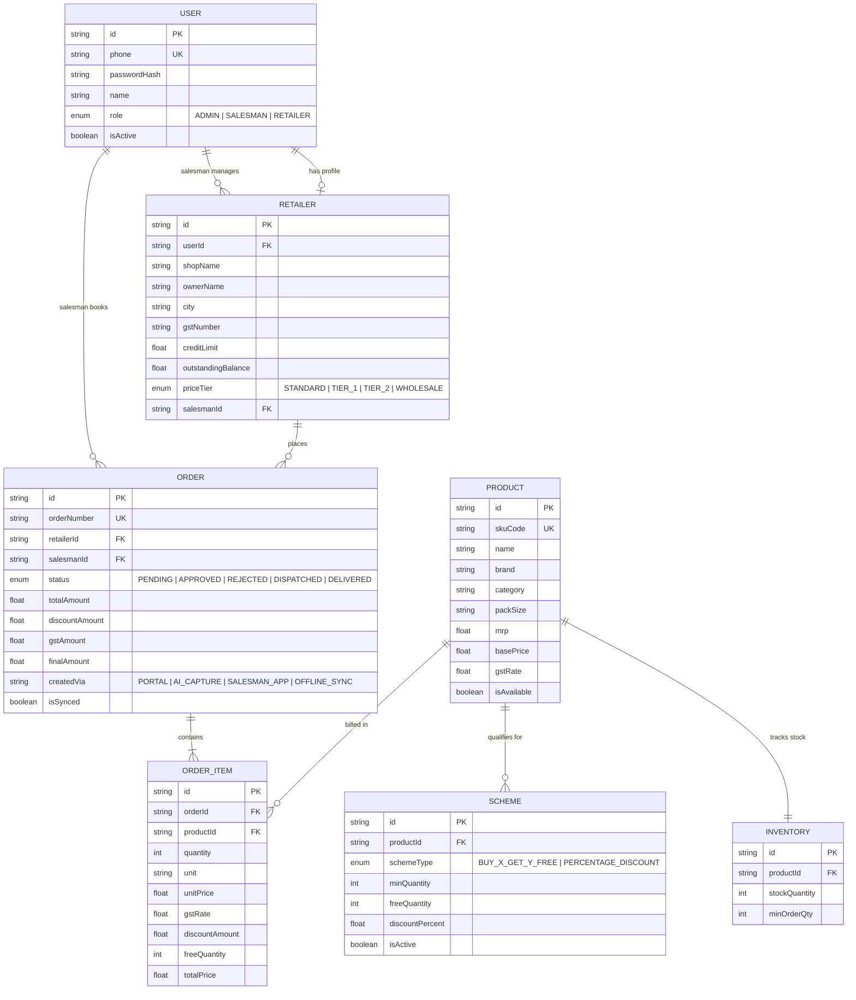
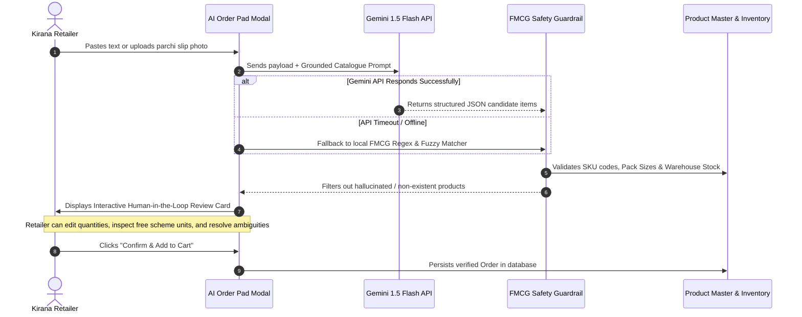

# Technical Design Document (TDD) — SupplySetu (सप्लाईसेतु)
### AI-Powered B2B Ordering & Distribution Management Platform for FMCG Wholesalers

> **Project Repository:** [https://github.com/krishnayadav9793/SupplySetu](https://github.com/krishnayadav9793/SupplySetu)  
> **Live Staging Application:** [https://supplysetu.vercel.app](https://supplysetu.vercel.app) *(or deployed staging URL)*  
> **Author & Lead Engineer:** Lead Full-Stack Architect  
> **Client Context:** Packaged Food & Home-Care Wholesale Distributor, Jabalpur, Madhya Pradesh, India  
> **Build Scope:** 7-Day End-to-End Core Build with Verified Production Slice

---

## Executive Summary & Problem Context

In Tier-2 and Tier-3 Indian distribution markets such as Jabalpur (Madhya Pradesh), wholesale distributors bridge the supply gap between major FMCG conglomerates (e.g., Parle, ITC, HUL, Britannia) and thousands of fragmented neighborhood kirana stores. A typical distributor manages 1,800+ retail accounts, processes 600 orders daily, operates 18 beat salesmen, and generates ₹85–100 Cr in annual turnover.

Despite this scale, **the ordering interface remains entirely manual and chaotic**:
1. Retailers submit orders via unstructured Hinglish WhatsApp messages (*"bhaiya 5 peti parle-g chhota aur 2 peti surf excel 1 kilo"*), phone calls, or photographs of handwritten notebook slips (*parchi*).
2. Six office data-entry operators spend 4–5 hours every morning deciphering these messages, manually looking up SKU codes, calculating promotional schemes, and entering lines into Tally ERP.
3. Approximately 5% of orders contain misidentified pack sizes or out-of-stock items, resulting in returns, disputed ledger balances (*khata*), and lost delivery vehicle trips.
4. Beat salesmen visiting congested wholesale clusters (Lordganj, Sarafa, Ganjipura) face frequent cellular dead zones, rendering cloud-only apps useless.

**SupplySetu (सप्लाईसेतु)** is an end-to-end, AI-powered distribution platform engineered to eliminate these bottlenecks. It provides a multi-role web platform with multimodal Gemini AI order ingestion, an offline-first Dexie IndexedDB sync engine for salesmen, real-time credit-limit controls, and 1-click RFC-4180 Tally ERP CSV export.

---

## 1. System Architecture & Technical Tradeoffs

```
+-----------------------------------------------------------------------------------------+
|                                    CLIENT LAYER (React 18 + Vite)                       |
|                                                                                         |
|  +---------------------------+   +---------------------------+   +--------------------+ |
|  | Kirana Retailer Portal    |   | Beat Salesman App         |   | Admin Order Desk   | |
|  | - Multimodal AI Pad       |   | - Beat Route Sequence     |   | - 12-Col Live Desk | |
|  | - Tiered Dealer Rates     |   | - Offline Dexie DB Store  |   | - Tally ERP Export | |
|  | - Margin % vs MRP         |   | - Auto Re-sync Daemon     |   | - Executive KPIs   | |
|  +-------------+-------------+   +-------------+-------------+   +---------+----------+ |
+----------------|-------------------------------|---------------------------|------------+
                 |                               |                           |
                 | HTTPS / REST (JSON)           | Idempotent Sync           | HTTPS / REST
                 v                               v                           v
+-----------------------------------------------------------------------------------------+
|                                BACKEND SERVICE LAYER (Node.js + Express)                |
|                                                                                         |
|  +---------------------------+   +---------------------------+   +--------------------+ |
|  | Auth & RBAC Middleware    |   | Pricing & Scheme Engine   |   | Order Processing   | |
|  | - JWT Authentication      |   | - 4-Tier Dynamic Rates    |   | - Idempotency Lock | |
|  | - Role Guard Decorators   |   | - Buy X Get Y Free Engine |   | - State Transition | |
|  +---------------------------+   +---------------------------+   +--------------------+ |
|                                                                                         |
|  +---------------------------+   +---------------------------+   +--------------------+ |
|  | Multimodal AI Service     |   | Khata & Credit Guard      |   | ERP Export Service | |
|  | - Google Gemini 1.5 Flash |   | - Ledger Balance Watcher  |   | - RFC-4180 Stream  | |
|  | - Fuzzy FMCG Fallback     |   | - Auto Credit Hold System |   | - Rule 46 GST Calc | |
|  +---------------------------+   +---------------------------+   +--------------------+ |
+----------------|-----------------------------------------------------------|------------+
                 |                                                           |
                 | Prisma ORM v6 (Connection Pooling via PgBouncer :6543)     |
                 v                                                           v
+-----------------------------------------------------------------------------------------+
|                               DATA PERSISTENCE & CLOUD SERVICES                         |
|                                                                                         |
|   +------------------------------------+    +---------------------------------------+   |
|   | PostgreSQL 15 on Supabase          |    | External AI Engine                    |   |
|   | - Relational Schema with Enums     |    | - Google Gemini 1.5 Flash API         |   |
|   | - Strict Foreign Key Integrity     |    | - Fast Multimodal Vision & NLP        |   |
|   +------------------------------------+    +---------------------------------------+   |
+-----------------------------------------------------------------------------------------+
```

### 1.1 Architectural Rationale

| Layer | Selected Technology | Why Chosen Over Alternatives |
|---|---|---|
| **Frontend** | React 18, Vite, Tailwind CSS, Lucide React | **Zero-lag user experience:** Vite provides sub-second HMR and optimized production bundles. Tailwind CSS enables custom, touch-friendly UI components tailored for shopkeepers using budget smartphones without heavy component library overhead. |
| **Offline Storage** | Dexie.js (IndexedDB wrapper) | **Resilience in cellular dead-zones:** LocalStorage has a 5MB limit and blocks the main thread. Dexie provides indexed, asynchronous, transactional client storage that allows salesmen to create and store complete order payloads offline. |
| **Backend API** | Node.js, Express.js, TypeScript | **Type safety and rapid I/O:** TypeScript guarantees shared contract interfaces between API routes and database models. The asynchronous Node event loop handles bursty batch exports and AI webhook requests with minimal overhead. |
| **Database & ORM** | PostgreSQL (Supabase), Prisma ORM v6 | **ACID compliance and relational integrity:** Financial khata ledgers, stock locks, and multi-tier discount hierarchies demand strict relational constraints and transaction rollback guarantees that NoSQL databases cannot reliably provide. |
| **AI Ingestion** | Google Gemini 1.5 Flash (`@google/genai`) | **Low latency and native multimodal understanding:** Gemini 1.5 Flash processes both noisy Hinglish text and photographed handwritten *parchi* slips in under 1.5 seconds at a fraction of the cost of legacy vision OCR pipelines. |
| **ERP Bridge** | Streaming RFC-4180 CSV Engine | **Zero distributor onboarding friction:** Direct Tally XML sockets require static IP mappings and desktop ODBC drivers that distributors resist installing. A RFC-4180 compliant CSV export integrates into Tally ERP's native *Data Import* function without client-side setup. |

---

## 2. Data Model & Database Architecture

The database schema is designed with strict relational integrity, composite indices for high-frequency queries, and domain-specific enums.



### 2.1 Core Entities & Fields

1. **User:** Central identity store supporting mobile-based authentication with bcrypt-hashed credentials and role-based authorization.
2. **Retailer:** Profile storing merchant trade name, GSTIN, assigned price tier, credit ceiling (e.g., ₹50,000), current outstanding khata balance, and assigned salesman ID.
3. **Product & Inventory:** FMCG SKU master tracking packaging dimensions (e.g., `80g x 72 Pack`), HSN codes, MRP, base distributor price, applicable GST rate (5%, 12%, 18%), and live warehouse stock quantity.
4. **Scheme:** Promotional engine definitions mapping primary product requirements to free bonus products (`BUY_X_GET_Y_FREE`) or percentage rebates (`PERCENTAGE_DISCOUNT`).
5. **Order & OrderItem:** Master-detail sales transactional records storing computed dealer rates, applied discounts, GST splits (CGST/SGST), and channel provenance (`AI_CAPTURE`, `SALESMAN_APP`, etc.).

---

## 3. Main Business Logic Flows

### 3.1 Flow 1: Dynamic Pricing & Margin Transparency Engine

Distributors offer differentiated wholesale rates based on kirana purchase volume and payment history. SupplySetu encodes this in four deterministic pricing tiers:

$$\text{Dealer Rate} = \text{Base Price} \times (1 - \text{Tier Discount Rate})$$

$$\text{Retailer Margin \%} = \frac{\text{MRP} - \text{Dealer Rate}}{\text{MRP}} \times 100$$

| Tier Enum | Volume Category | Applied Discount | Example: Parle-G 80g (MRP ₹10.00 / Box Base ₹597.80) | Retailer Margin vs MRP |
|---|---|---|---|---|
| `STANDARD` | Walk-in / New Shop | 0.0% | ₹597.80 / box | 17.0% |
| `TIER_1` | Regular Monthly Kirana | 2.0% | ₹585.84 / box | 18.6% |
| `TIER_2` | High-Volume Semi-Wholesale | 4.0% | ₹573.89 / box | 20.3% |
| `WHOLESALE` | Sub-Distributor / Bulk Buyer | 6.5% | ₹558.94 / box | 22.4% |

**Taxes:** Prices are calculated with statutory GST applied to the net taxable base:
$$\text{Taxable Subtotal} = \text{Quantity} \times \text{Dealer Rate}$$
$$\text{GST Amount} = \text{Taxable Subtotal} \times \frac{\text{GST Rate}}{100}$$
For intra-state transactions in Madhya Pradesh (State Code 23), the system splits this into 50% CGST and 50% SGST according to GST Rule 46.

---

### 3.2 Flow 2: Automated Trade Scheme Engine

Promotional schemes are evaluated during cart aggregation and order placement:
- **Buy X Get Y Free:** If order item quantity $Q \ge Q_{\min}$, bonus units are calculated deterministically:
  $$Q_{\text{free}} = \left\lfloor \frac{Q}{Q_{\min}} \right\rfloor \times Q_{\text{bonus}}$$
  *Example:* Parle-G (Buy 10 Get 1 Free). Ordering 25 boxes automatically adds $\lfloor 25/10 \rfloor \times 1 = 2$ free boxes without inflating the billable line item total.
- **Volume Percentage Discount:** If $Q \ge Q_{\min}$, an additional trade discount is deducted from the line subtotal:
  $$\text{Discount Amount} = Q \times \text{Dealer Rate} \times \frac{\text{Discount \%}}{100}$$

---

### 3.3 Flow 3: Credit Limit & Khata Control Circuit

To protect wholesale distributors from bad debt, every order must pass automated credit verification:

$$\text{Projected Balance} = \text{Outstanding Balance} + \text{New Order Final Amount}$$

- If $\text{Projected Balance} \le \text{Credit Limit}$: Order status is set to `PENDING` (Normal Queue).
- If $\text{Projected Balance} > \text{Credit Limit}$: Order is flagged with `CREDIT_HOLD`. 
  - The retailer receives a warning explaining that their credit limit of ₹50,000 has been exceeded by ₹X.
  - The Distributor Admin receives a visual alert on the Order Desk with ledger details and must explicitly authorize the credit exception before dispatch.

---

## 4. How the AI Part Works: Multimodal Parsing & Safety Guardrails

The AI ingestion pipeline converts unstructured natural-language Hinglish messages and photographed notebook slips (*parchi*) into verified, structured cart items.



### 4.1 Ingestion Channels
1. **Unstructured Hinglish / Hindi Text:** Handles phonetic colloquialisms common in central India, such as:
   - *"5 peti parle g chhota"* $\rightarrow$ Parle-G 80g Glucose Biscuits (5 Boxes).
   - *"2 carton surf excel ek kilo"* $\rightarrow$ Surf Excel Quick Wash 1kg (2 Boxes).
   - *"1 darjan maggi"* $\rightarrow$ Maggi 2-Minute Masala Noodles 70g (12 Units / Pack).
2. **Photographed Handwritten Parchi:** Image input is passed directly to Gemini 1.5 Flash Vision to transcribe Hindi/English merchant notes without requiring an intermediate OCR engine.

### 4.2 Prompt Engineering & Catalogue Grounding
The LLM is prompted with the active product master as a fixed schema anchor:
- Only products present in the provided catalogue may be matched.
- Quantities must be normalized into standard wholesale packaging units (`BOX`, `CARTON`, `PIECE`).
- Each parsed item is assigned a confidence score between `0.0` and `1.0`.

### 4.3 Deterministic Fallback & Safety Rules
- **Anti-Hallucination Guardrail:** If an extracted SKU code does not match a verified database record with $\ge 85\%$ string similarity, it is rejected and marked as an unmapped note rather than guessing a wrong product.
- **Network Timeout Fallback:** If the Gemini API takes longer than 8 seconds (or in cases of rate limits), the backend automatically falls back to an internal FMCG fuzzy regex dictionary (`ai.service.ts`). This extracts numbers, units (`peti`, `kilo`, `darjan`), and brand tokens locally without failing the user's request.
- **Human-in-the-Loop Verification:** AI output is **never** committed directly to the database as a finalized invoice. It always renders an interactive review modal where the retailer or salesman can adjust quantities, fix unrecognized lines, and verify prices before submission.

---

## 5. Offline-First Beat Salesman Engine

Salesmen in rural or dense market areas regularly lose internet connectivity. SupplySetu implements a reliable offline architecture using Dexie.js (IndexedDB).

### 5.1 Local Storage & Idempotency Lock
When a salesman launches the app, the active product catalogue and assigned retailer list are cached locally in IndexedDB.
When an order is created without connectivity:
1. The client generates a cryptographically random RFC-4122 UUID v4 as a client-side idempotency key (`clientOrderId`).
2. The entire order payload (retailer ID, item array, timestamp, local total) is saved to the Dexie `offlineOrders` object store with status `PENDING_SYNC`.
3. The UI updates optimistically, showing an offline pending badge (*"1 order queued for sync"*).

### 5.2 Background Sync & Conflict Resolution
- A global network listener (`window.addEventListener('online', ...)`) detects restored connectivity.
- The sync service loops through queued orders and submits them to `POST /api/orders/sync`.
- The server checks the `clientOrderId`. If an order with that key already exists, the server returns the existing record without creating a duplicate.
- Once successfully acknowledged, the local IndexedDB record status flips to `SYNCED` and clears from the queue.

---

## 6. UI & Design Decisions: Key Screens & UX Flow

The user interface is built mobile-first using a clean design system (Tailwind CSS) engineered for high clarity, fast data entry, and distinct role workflows.

```
+-----------------------------------------------------------------------------------------+
| [SupplySetu]  Shri Ganesh Kirana Store (Tier 1)         [Search FMCG Catalogue...] (Cart: 3)|
+-----------------------------------------------------------------------------------------+
| [ AI Order Pad (WhatsApp / Parchi) ]   [ Active Schemes ]   [ Credit: ₹38,200 / ₹50,000 ]|
+-----------------------------------------------------------------------------------------+
|                                                                                         |
|  +---------------------------+   +---------------------------+   +--------------------+ |
|  | Parle-G Glucose 80g       |   | Surf Excel Quick Wash 1kg |   | Maggi Noodles 70g  | |
|  | Pack: 72 Pcs / Box        |   | Pack: 24 Pcs / Carton     |   | Pack: 96 Pcs / Box | |
|  | MRP: ₹10.00 / pc          |   | MRP: ₹145.00 / pc         |   | MRP: ₹14.00 / pc   | |
|  | Dealer Rate: ₹585.84/box  |   | Dealer Rate: ₹3,120.00/ctn|   | Dealer Rate: ₹1,180| |
|  | [Your Margin: 18.6%]      |   | [Your Margin: 10.3%]      |   | [Your Margin: 12%] | |
|  | SCHEME: Buy 10 Get 1 Free |   | SCHEME: 5% Off on 5+      |   | Stock: 140 Boxes   | |
|  |                           |   |                           |                        | |
|  | [-] [ 10 ] [+] [Add Box]  |   | [-] [  2 ] [+] [Add Ctn]  |   | [ Out of Stock ]   | |
|  +---------------------------+   +---------------------------+   +--------------------+ |
|                                                                                         |
+-----------------------------------------------------------------------------------------+
```

### 6.1 Retailer Ordering Interface (`RetailerDashboard.tsx`)
- **Visual Margin Badge:** Displays the exact profit percentage the retailer earns against MRP (e.g. `Your Margin: 18.6%`) next to their net dealer rate. This builds trust and encourages larger basket sizes.
- **Stock Badges & Scheme Tags:** Real-time green/red availability indicators prevent retailers from ordering depleted inventory. Prominent scheme pills explain savings directly on the product card.
- **One-Click Repeat Order:** A single button replicates the retailer's previous approved basket into a fresh order, saving regular shopkeepers significant time.

### 6.2 AI Order Pad Modal (`AiOrderPadModal.tsx`)
- **Split Ingestion View:** Supports pasted Hinglish text, voice input dictation, or photographic image upload (*parchi*).
- **Interactive Review Table:** Color-coded confidence pills (green $\ge 90\%$, yellow $70\text{--}89\%$) and dropdowns allow the shopkeeper to verify each extracted item, adjust carton quantities, and inspect free scheme units before touching their credit line.

### 6.3 Salesman Beat Order Pad (`SalesmanDashboard.tsx`)
- **Beat Hierarchy:** Groups kirana stores by geographical beat sequence (e.g., Beat #4 Lordganj & Sarafa Sector).
- **Credit Exposure Barometer:** Shows the merchant's real-time ledger balance (*khata*) before the salesman enters the shop, avoiding orders for retailers with frozen credit.
- **Offline Mode Indicator:** An unobtrusive amber/green banner informs the salesman of network status and pending sync count.

### 6.4 Distributor 12-Column Live Order Desk (`AdminDashboard.tsx`)
- **Operational Command Center:** A data-dense, desktop-optimized table displaying Order ID, Retailer Name, Area, Total Items, Gross Value, Tax, Applied Schemes, Channel Tag, and Credit Check Status.
- **Credit Hold Alerts:** Orders breaching credit limits are highlighted in red with an explicit override button.
- **One-Click Tally ERP Export:** Generates an RFC-4180 CSV export formatted with exact Tally ERP accounting headers (HSN, taxable base, CGST, SGST, GSTIN).
- **Executive Analytics & Kirana Churn Radar:** Highlights retailers who have not ordered in 14+ days, complete with a **1-Click WhatsApp Re-engagement Link** with pre-filled greeting text.

---

## 7. Scope Boundaries: What Was Cut & What Comes Next

### 7.1 Features Deliberately Cut During the 7-Day Build

| Cut Feature | Technical & Business Justification | Chosen Alternative |
|---|---|---|
| **Native Android APK** | Building, signing, and distributing an Android APK across fragmented device models requires extensive QA and Play Store approvals, introducing setup friction for non-technical shopkeepers. | Built an edge-to-edge responsive Progressive Web App (PWA) with Dexie IndexedDB offline support that runs instantly in any mobile browser without installation. |
| **Direct Tally XML Socket Daemon** | Direct bidirectional XML communication with Tally requires installing a background daemon on the distributor's office computer, configuring static public IPs, and dealing with firewall restrictions. | Built a streaming RFC-4180 compliant CSV export engine matching Tally ERP's native import template, allowing immediate adoption with zero infrastructure changes. |
| **Real-Time Payment Gateway Integration** | In wholesale FMCG, kiranas operate on rolling 7 to 15-day credit (*khata*) rather than instant UPI/card payments at order time. Immediate settlement checkout would have introduced friction. | Implemented a dedicated Khata Ledger management system with credit ceilings, payment collection logging, and balance tracking. |

### 7.2 Post-Submission Implementation Roadmap (Next Steps)
1. **WhatsApp Cloud API Webhook Bot:** Direct integration with Meta's official WhatsApp Business API so kirana owners can message orders straight to the distributor's WhatsApp number, which will trigger the Gemini extraction service automatically.
2. **GeoJSON Salesman Beat Optimization:** Automated traveling salesperson route calculation using OpenStreetMap / Google Maps routing to minimize salesman travel time between kiranas.
3. **Predictive Kirana Replenishment:** Machine learning models that analyze ordering cadence and automatically suggest replenishment carts to shopkeepers before fast-moving staples run out.
4. **Automated Tally ODBC Sync Daemon:** An optional lightweight Windows background service that monitors the export queue and synchronizes approved invoices directly into Tally's local SQLite/XML datastore.

---

## 8. Explicit System Assumptions

1. **State GST Jurisdiction:** The distribution territory is assumed to be Jabalpur, Madhya Pradesh. All intra-state transactions apply a 50/50 split between CGST and SGST using State Code 23.
2. **Standard Commercial Packaging Units:** Products are sold in commercial wholesale packaging (`BOX`, `CARTON`, `BAG`). Loose retail pieces are not sold directly from the wholesale warehouse.
3. **Credit Verification Cycle:** Retailer credit limits are reviewed on rolling 15-day settlement cycles. Credit holds require administrative authorization before an invoice can be dispatched.
4. **Single-Distributor Tenancy:** The current system assumes a single distributor entity supplying multiple retail merchants across defined geographical beats. Multi-distributor marketplace isolation is planned for future phases.
5. **Simulated OTP Authentication:** To provide a reliable evaluation experience without relying on third-party SMS delivery gateways (DLT regulations in India), SMS OTP verification is simulated using fixed demo credentials.

---

## 9. Verification & Automated Test Coverage

The platform includes an automated business logic verification suite (`server/src/tests/suite.ts`) covering all 31 critical business rules:

```bash
npm --prefix server test
```

### Verified Test Categories (31 Tests, 100% Pass Rate):
1. **Pricing Tiers:** Standard (0%), Tier 1 (2%), Tier 2 (4%), Wholesale (6.5%), dealer rate and margin % calculations vs MRP.
2. **Trade Scheme Engine:** `BUY_X_GET_Y_FREE` minimum thresholds, multiple bracket allocations, and volume discount math.
3. **Credit Limit Controls:** Clean approvals within limit vs automated credit hold flags when orders exceed credit ceilings.
4. **Offline Synchronization:** Client-side UUID idempotency generation (`clientOrderId`) and duplicate prevention logic.
5. **Tally ERP Export:** RFC-4180 quotation escaping for merchant names with commas, and mandatory ERP column structure.
6. **Multimodal AI Safety:** Parchi slip transcription, fallback dictionary parsing on timeout, and anti-hallucination non-catalogue SKU rejection.
7. **Khata Ledger & Financial Aging:** Outstanding balance updates upon collection, receivables aging brackets (0–15d, 16–30d, 30+d), and high-utilization alerts ($\ge 80\%$).
8. **B2B Tax Invoicing:** Rule 46 CGST/SGST 50/50 intra-state splitting for MP code 23 and HSN Chapter classification.
9. **Order Lifecycle & Retention:** Status state machine (`PENDING` $\rightarrow$ `APPROVED` $\rightarrow$ `DISPATCHED` $\rightarrow$ `DELIVERED`), 1-click repeat orders, and 14-day kirana churn detection with WhatsApp re-engagement URL generation.
